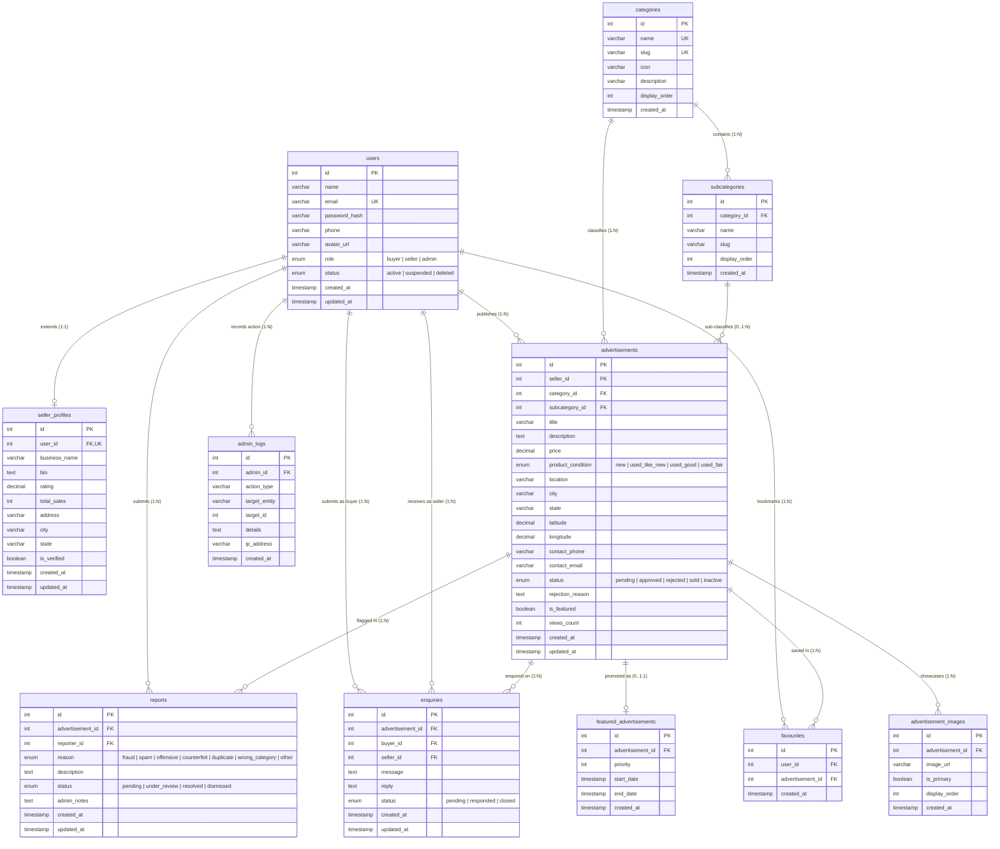
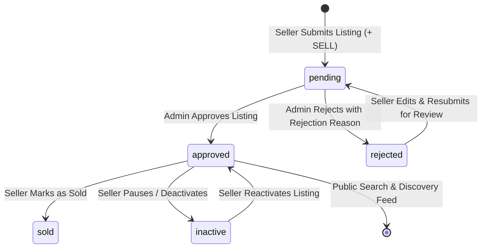

# NEIGHSHOP GLOBAL — TECHNICAL SELECTION ASSIGNMENT
## Modern OLX-Inspired Classified Marketplace Full-Stack Platform

**Candidate Name:** Vansh  
**Project Category:** Classified Marketplace / E-Commerce Platform  
**Purpose:** Candidate Selection and Technical Evaluation  
**Assigned By:** Neighshop Global Technical Evaluation Team  

---

## 1. Project Architecture Overview

The system strictly adheres to the technical specification, delivering **three distinct client applications** communicating with a unified, shared Node.js/Express TypeScript backend and a normalized MySQL database (with automatic zero-config fallback to SQLite for immediate evaluator review):

```
                               ┌──────────────────────────────────────────────────────────┐
                               │                 Shared Backend API                       │
                               │          (Node.js + Express.js + TypeScript)             │
                               │        JWT Auth • RBAC • Multer • RESTful APIs           │
                               └────────────────────────────┬─────────────────────────────┘
                                                            │
                       ┌────────────────────────────────────┼────────────────────────────────────┐
                       │                                    │                                    │
                       ▼                                    ▼                                    ▼
       ┌───────────────────────────────┐    ┌───────────────────────────────┐    ┌───────────────────────────────┐
       │     User Mobile App           │    │    Seller Mobile App          │    │       Admin Web Panel         │
       │ (React Native + TypeScript +  │    │ (React Native + TypeScript +  │    │     (React.js + TypeScript    │
       │       React Navigation)       │    │       React Navigation)       │    │      Responsive Web App)      │
       │                               │    │                               │    │                               │
       │ • Location & City Picker      │    │ • Seller Studio & Analytics   │    │ • Executive KPI Dashboard     │
       │ • Horizontal Category Pills   │    │ • Structured + SELL Ad Form   │    │ • Listing Moderation Queue    │
       │ • 2-Column OLX Product Feed   │    │ • Multi-Photo Upload Selector │    │ • Full Inventory Management   │
       │ • Multi-Criteria Condition    │    │ • Inventory Status Tracker:   │    │ • User Account Moderation     │
       │ • Detailed Product View &     │    │   (Active, Pending, Rejected, │    │ • Category/Subcategory CRUD   │
       │   Photo Gallery Carousel      │    │    Sold with Admin Feedback)  │    │ • Complaints & Safety Center  │
       │ • Buyer Inquiries & Chat CTA  │    │ • Buyer Inquiries Hub & Call  │    │ • Audit Activity Logs         │
       │ • Wishlist / Saved Ads        │    │ • Seller Storefront Editor    │    │ • Role-Based Protected Routes │
       │ • Report Advertisement        │    │ • Verified Merchant Badge     │    │ • Single-Click Autofill Demo  │
       └───────────────────────────────┘    └───────────────────────────────┘    └───────────────────────────────┘
                                                            │
                                                            ▼
                                           ┌──────────────────────────────────┐
                                           │       MySQL 8.0+ Database        │
                                           │   (Normalized Relational Schema) │
                                           │  Zero-config fallback: SQLite    │
                                           └──────────────────────────────────┘
```

> **Evaluation Flexibility:** To ensure evaluators can immediately explore the entire mobile experience inside any web browser without needing physical mobile devices or Android/iOS simulators, a high-fidelity **interactive mobile simulator** (`mobile-app/`) is also pre-configured on port 5174, allowing instant switching between Buyer and Seller perspectives!

---

## 2. Milestone 2: MySQL Relational Database Design

The database schema is fully normalized (3NF), adhering to relational design principles with explicit foreign key constraints, composite and single-column indexes, deletion rules, and status lifecycle state machines.

### 2.1 Entity-Relationship (ER) Diagram



---

### 2.2 Table-by-Table Relational Schema Reference

#### 1. `users`
- **Purpose:** Core identity, credential storage, role definition, and moderation status.
- **Key Columns:**
  - `id INT AUTO_INCREMENT PRIMARY KEY`
  - `name VARCHAR(100) NOT NULL`
  - `email VARCHAR(150) NOT NULL UNIQUE` (Unique constraint prevents duplicate accounts)
  - `password_hash VARCHAR(255) NOT NULL` (Standard bcrypt hashed credentials)
  - `phone VARCHAR(20) NULL`
  - `role ENUM('buyer', 'seller', 'admin') NOT NULL DEFAULT 'buyer'`
  - `status ENUM('active', 'suspended', 'deleted') NOT NULL DEFAULT 'active'`
  - `created_at`, `updated_at TIMESTAMP`
- **Indexes:** `idx_user_email (email)`, `idx_user_role (role)`, `idx_user_status (status)`.

#### 2. `seller_profiles`
- **Purpose:** 1-to-1 extension of `users` storing verified merchant storefront details, physical pickup addresses, and buyer feedback ratings.
- **Key Columns:**
  - `id INT AUTO_INCREMENT PRIMARY KEY`
  - `user_id INT NOT NULL UNIQUE` (Strict 1-to-1 relationship with `users`)
  - `business_name VARCHAR(150) NULL`
  - `bio TEXT NULL`
  - `rating DECIMAL(3, 2) DEFAULT 5.00`
  - `total_sales INT DEFAULT 0`
  - `address VARCHAR(255) NULL`, `city VARCHAR(100)`, `state VARCHAR(100)`
  - `is_verified BOOLEAN DEFAULT FALSE`
- **Foreign Key:** `FOREIGN KEY (user_id) REFERENCES users(id) ON DELETE CASCADE`.
- **Indexes:** `idx_seller_city (city)`, `idx_seller_verified (is_verified)`.

#### 3. `categories` & `subcategories`
- **Purpose:** Two-tier classification taxonomy for structured browsing and filtering.
- **Key Columns (`categories`):**
  - `id INT AUTO_INCREMENT PRIMARY KEY`
  - `name VARCHAR(100) NOT NULL UNIQUE`, `slug VARCHAR(120) NOT NULL UNIQUE`
  - `icon VARCHAR(100) NOT NULL DEFAULT 'tag'`, `description VARCHAR(255)`
  - `display_order INT DEFAULT 0`
- **Key Columns (`subcategories`):**
  - `id INT AUTO_INCREMENT PRIMARY KEY`
  - `category_id INT NOT NULL`
  - `name VARCHAR(100) NOT NULL`, `slug VARCHAR(120) NOT NULL`
  - `UNIQUE KEY uq_cat_subcat (category_id, slug)` (Slug uniqueness within parent category)
- **Foreign Key:** `FOREIGN KEY (category_id) REFERENCES categories(id) ON DELETE CASCADE`.

#### 4. `advertisements`
- **Purpose:** Central entity storing classified advertisements posted by sellers.
- **Key Columns:**
  - `id INT AUTO_INCREMENT PRIMARY KEY`
  - `seller_id INT NOT NULL`
  - `category_id INT NOT NULL`
  - `subcategory_id INT NULL`
  - `title VARCHAR(150) NOT NULL`, `description TEXT NOT NULL`
  - `price DECIMAL(12, 2) NOT NULL` (Indexed for price bracket filters)
  - `product_condition ENUM('new', 'used_like_new', 'used_good', 'used_fair') DEFAULT 'used_good'`
  - `location VARCHAR(150)`, `city VARCHAR(100)`, `state VARCHAR(100)`
  - `status ENUM('pending', 'approved', 'rejected', 'sold', 'inactive') NOT NULL DEFAULT 'pending'`
  - `rejection_reason TEXT NULL` (Stores specific moderator explanation for rejected ads)
  - `is_featured BOOLEAN DEFAULT FALSE`
  - `views_count INT DEFAULT 0`
- **Foreign Keys & Deletion Rules:**
  - `FOREIGN KEY (seller_id) REFERENCES users(id) ON DELETE CASCADE` (Removing user removes ads)
  - `FOREIGN KEY (category_id) REFERENCES categories(id) ON DELETE RESTRICT` (**Defensive integrity rule:** Prevents accidental deletion of categories that have active advertisements!)
  - `FOREIGN KEY (subcategory_id) REFERENCES subcategories(id) ON DELETE SET NULL` (Allows subcategory refactoring without losing ads)
- **Indexes:** `idx_ad_status (status)`, `idx_ad_search_public (status, city, category_id, created_at)`, `idx_ad_price (price)`, `idx_ad_featured (is_featured)`.

#### 5. `advertisement_images`
- **Purpose:** Multi-photo gallery per advertisement.
- **Key Columns:**
  - `id INT AUTO_INCREMENT PRIMARY KEY`
  - `advertisement_id INT NOT NULL`
  - `image_url VARCHAR(500) NOT NULL`
  - `is_primary BOOLEAN DEFAULT FALSE` (Identifies hero/cover photo for feeds)
  - `display_order INT DEFAULT 0`
- **Foreign Key:** `FOREIGN KEY (advertisement_id) REFERENCES advertisements(id) ON DELETE CASCADE`.
- **Indexes:** `idx_image_ad_primary (advertisement_id, is_primary)`.

#### 6. `favourites`
- **Purpose:** Buyer saved listings / wishlist.
- **Key Columns:**
  - `id INT AUTO_INCREMENT PRIMARY KEY`
  - `user_id INT NOT NULL`, `advertisement_id INT NOT NULL`
  - `created_at TIMESTAMP DEFAULT CURRENT_TIMESTAMP`
  - `UNIQUE KEY uq_user_ad_fav (user_id, advertisement_id)` (**Prevents duplicate bookmarking**)
- **Foreign Keys:** Both `user_id` and `advertisement_id` cascade on delete.

#### 7. `enquiries`
- **Purpose:** Direct buyer-to-seller inquiry messages on specific advertisements.
- **Key Columns:**
  - `id INT AUTO_INCREMENT PRIMARY KEY`
  - `advertisement_id INT NOT NULL`
  - `buyer_id INT NOT NULL`, `seller_id INT NOT NULL`
  - `message TEXT NOT NULL`, `reply TEXT NULL`
  - `status ENUM('pending', 'responded', 'closed') NOT NULL DEFAULT 'pending'`
- **Foreign Keys:** `advertisement_id`, `buyer_id`, and `seller_id` all reference respective entities with `ON DELETE CASCADE`.
- **Indexes:** `idx_enquiry_ad (advertisement_id)`, `idx_enquiry_seller (seller_id)`, `idx_enquiry_buyer (buyer_id)`.

#### 8. `reports`
- **Purpose:** Community safety violation reports (spam, counterfeit, fraud, harassment).
- **Key Columns:**
  - `id INT AUTO_INCREMENT PRIMARY KEY`
  - `advertisement_id INT NOT NULL`, `reporter_id INT NOT NULL`
  - `reason ENUM('fraud', 'spam', 'offensive', 'counterfeit', 'duplicate', 'wrong_category', 'other') NOT NULL`
  - `description TEXT NULL`
  - `status ENUM('pending', 'under_review', 'resolved', 'dismissed') NOT NULL DEFAULT 'pending'`
  - `admin_notes TEXT NULL`
- **Foreign Keys:** Both reference `advertisements(id)` and `users(id)` with `ON DELETE CASCADE`.

#### 9. `featured_advertisements`
- **Purpose:** Dedicated promotion schedule table for high-visibility homepage banner spots.
- **Key Columns:**
  - `id INT AUTO_INCREMENT PRIMARY KEY`
  - `advertisement_id INT NOT NULL`
  - `priority INT DEFAULT 1`
  - `start_date TIMESTAMP DEFAULT CURRENT_TIMESTAMP`, `end_date TIMESTAMP NULL`
- **Foreign Key:** `FOREIGN KEY (advertisement_id) REFERENCES advertisements(id) ON DELETE CASCADE`.

#### 10. `admin_logs`
- **Purpose:** Immutable administrative security audit trail tracking moderation decisions.
- **Key Columns:**
  - `id INT AUTO_INCREMENT PRIMARY KEY`
  - `admin_id INT NOT NULL`
  - `action_type VARCHAR(50) NOT NULL` (e.g. `approve_ad`, `reject_ad`, `suspend_user`, `delete_category`)
  - `target_entity VARCHAR(50) NOT NULL`, `target_id INT NULL`
  - `details TEXT NULL` (Stores audit context including rejection reasons or suspension causes)
  - `ip_address VARCHAR(45) NULL`
- **Foreign Key:** `FOREIGN KEY (admin_id) REFERENCES users(id) ON DELETE CASCADE`.

---

### 2.3 Explicit Advertisement Status Workflow



> **Public Search Isolation Rule:** The public marketplace query unconditionally enforces `WHERE status = 'approved'`, guaranteeing that listings with statuses `pending`, `rejected`, `sold`, or `inactive` are strictly excluded from public buyer feeds and search results!

---

### 2.4 Six Production-Grade Sample SQL Queries

#### Query 1: Public Marketplace Feed (Filtered, Ordered & Joined)
*Only retrieves approved, active listings matching user search criteria, joining primary image and checking wishlist status:*
```sql
SELECT 
    a.id,
    a.title,
    a.price,
    a.product_condition,
    a.location,
    a.city,
    a.created_at,
    a.is_featured,
    c.name AS category_name,
    c.icon AS category_icon,
    img.image_url AS primary_image,
    EXISTS(SELECT 1 FROM favourites f WHERE f.user_id = 3 AND f.advertisement_id = a.id) AS is_favourited
FROM advertisements a
JOIN categories c ON a.category_id = c.id
LEFT JOIN advertisement_images img ON img.advertisement_id = a.id AND img.is_primary = TRUE
WHERE a.status = 'approved'
  AND (LOWER(a.city) = 'mumbai')
  AND (a.category_id = 1)
  AND (a.price BETWEEN 10000 AND 80000)
ORDER BY a.is_featured DESC, a.created_at DESC
LIMIT 12 OFFSET 0;
```

#### Query 2: Admin Moderation Queue (Pending Review)
*Retrieves all pending advertisements requiring moderation with seller contact information:*
```sql
SELECT 
    a.id,
    a.title,
    a.price,
    a.created_at,
    a.product_condition,
    a.city,
    u.name AS seller_name,
    u.email AS seller_email,
    sp.is_verified AS seller_verified,
    c.name AS category_name,
    (SELECT image_url FROM advertisement_images WHERE advertisement_id = a.id ORDER BY is_primary DESC, id ASC LIMIT 1) AS thumbnail
FROM advertisements a
JOIN users u ON a.seller_id = u.id
JOIN categories c ON a.category_id = c.id
LEFT JOIN seller_profiles sp ON sp.user_id = u.id
WHERE a.status = 'pending'
ORDER BY a.created_at ASC;
```

#### Query 3: Admin Moderation Action (Rejection with Feedback & Audit Logging)
*Atomic transaction rejecting an ad, storing the rejection explanation, and recording an immutable audit log entry:*
```sql
START TRANSACTION;

-- 1. Update advertisement status to rejected and store explanation
UPDATE advertisements 
SET status = 'rejected',
    rejection_reason = 'Counterfeit goods policy violation: Replica items are strictly prohibited on NeighShop.',
    updated_at = CURRENT_TIMESTAMP
WHERE id = 11 AND status = 'pending';

-- 2. Insert audit log record
INSERT INTO admin_logs (admin_id, action_type, target_entity, target_id, details, ip_address)
VALUES (1, 'reject_ad', 'advertisement', 11, 'Rejected listing due to brand trademark violation.', '192.168.1.100');

COMMIT;
```

#### Query 4: Seller Inventory Overview with Status Breakdown
*Fetches seller listings grouped by status along with view counts and admin feedback for rejected ads:*
```sql
SELECT 
    a.id,
    a.title,
    a.price,
    a.status,
    a.rejection_reason,
    a.views_count,
    a.created_at,
    (SELECT COUNT(*) FROM enquiries e WHERE e.advertisement_id = a.id) AS total_inquiries,
    (SELECT image_url FROM advertisement_images WHERE advertisement_id = a.id ORDER BY is_primary DESC, id ASC LIMIT 1) AS primary_image
FROM advertisements a
WHERE a.seller_id = 2
ORDER BY 
    CASE a.status 
        WHEN 'rejected' THEN 1
        WHEN 'pending' THEN 2
        WHEN 'approved' THEN 3
        ELSE 4
    END,
    a.created_at DESC;
```

#### Query 5: Buyer Enquiry Threading & Response Tracking
*Retrieves all buyer inquiries for a seller, joining buyer details and product thumbnail:*
```sql
SELECT 
    e.id AS enquiry_id,
    e.message,
    e.reply,
    e.status AS enquiry_status,
    e.created_at AS received_at,
    u.name AS buyer_name,
    u.phone AS buyer_phone,
    a.id AS advertisement_id,
    a.title AS ad_title,
    a.price AS ad_price,
    (SELECT image_url FROM advertisement_images WHERE advertisement_id = a.id ORDER BY is_primary DESC, id ASC LIMIT 1) AS ad_thumbnail
FROM enquiries e
JOIN users u ON e.buyer_id = u.id
JOIN advertisements a ON e.advertisement_id = a.id
WHERE e.seller_id = 2
ORDER BY e.created_at DESC;
```

#### Query 6: Safety Complaint Center & Automatic Violating Ad Suspension
*Finds unresolved reports and provides administrative resolution with automatic ad removal:*
```sql
-- Identify high-priority complaints
SELECT 
    r.id AS report_id,
    r.reason,
    r.description,
    r.created_at,
    reporter.name AS reported_by,
    a.id AS advertisement_id,
    a.title AS ad_title,
    seller.name AS seller_name
FROM reports r
JOIN users reporter ON r.reporter_id = reporter.id
JOIN advertisements a ON r.advertisement_id = a.id
JOIN users seller ON a.seller_id = seller.id
WHERE r.status = 'pending'
ORDER BY r.created_at ASC;

-- Resolve complaint & suspend violating ad
START TRANSACTION;

UPDATE reports 
SET status = 'resolved',
    admin_notes = 'Listing verified as fraudulent; listing taken down immediately.'
WHERE id = 1;

UPDATE advertisements 
SET status = 'rejected',
    rejection_reason = 'Removed by administrator due to community safety complaint.'
WHERE id = 11;

INSERT INTO admin_logs (admin_id, action_type, target_entity, target_id, details)
VALUES (1, 'resolve_report', 'report', 1, 'Resolved report and rejected advertisement #11.');

COMMIT;
```

---

### 2.5 Automated Database Verification Suite

A dedicated verification script [backend/scripts/verify-database.ts](file:///c:/Users/verma/OneDrive/Desktop/Project/backend/scripts/verify-database.ts) confirms that the schema can be initialized from scratch and that all relational rules function correctly:

```bash
cd backend
npm run test:db
```

**Verification Steps Executed by the Test Suite:**
1. **Table Inventory:** Confirms all 10 tables exist and are queryable.
2. **Status Lifecycles:** Inserts an ad, verifies transitions through all 5 explicit statuses (`pending`, `approved`, `rejected`, `sold`, `inactive`), and confirms `rejection_reason` storage.
3. **Public Search Isolation:** Queries public feed and verifies that inactive/pending/rejected/sold ads are 100% excluded.
4. **Cascade Deletion:** Attaches images, wishlist bookmarks, inquiries, reports, and featured records to an ad, deletes the ad, and verifies that `ON DELETE CASCADE` automatically purges child records without leaving orphans.
5. **Uniqueness Constraints:** Attempts inserting duplicate emails, duplicate bookmarks, and duplicate category slugs, verifying that all are cleanly rejected.

---

## 3. Milestone 3: Shared REST API Architecture & Implementation

The shared REST API is built with **Node.js, Express.js, TypeScript**, and backed by the normalized MySQL schema (with automatic zero-config fallback to SQLite). It enforces strict backend validation, parameterized queries, bcrypt password hashing, robust role-based access control (RBAC), and deterministic HTTP status codes across 11 functional modules.

### 3.1 Modular API Architecture
```
backend/src/
├── config/env.ts              # Environment configuration & validation
├── controllers/               # Business logic, authorization & database execution
│   ├── authController.ts      # Registration, login, logout, profile & role switching
│   ├── categoryController.ts  # Taxonomy navigation & live approved ad counters
│   ├── adController.ts        # Ad CRUD, image ingestion & ownership verification
│   ├── wishlistController.ts  # Favourites bookmarking & status checks
│   ├── enquiryController.ts   # Buyer inquiries & seller response management
│   ├── adminController.ts     # Moderation queue, user management, stats & logs
│   ├── reportController.ts    # Safety complaints & violating ad takedowns
│   └── userController.ts      # Public seller storefront profiles & active listings
├── middleware/                # Security & request pipelines
│   ├── auth.ts                # Bearer JWT verification & active user hydration
│   ├── rbac.ts                # Role barriers (requireBuyer, requireSeller, requireAdmin)
│   ├── upload.ts              # Multer multi-photo upload handler
│   └── errorHandler.ts        # Centralized 404 & 500 error sanitization
├── routes/                    # RESTful route definitions mounted on /api
│   ├── auth.routes.ts         # /api/auth
│   ├── category.routes.ts     # /api/categories
│   ├── ad.routes.ts           # /api/advertisements
│   ├── wishlist.routes.ts     # /api/wishlist
│   ├── enquiry.routes.ts      # /api/enquiries
│   ├── report.routes.ts       # /api/reports
│   ├── admin.routes.ts        # /api/admin
│   └── user.routes.ts         # /api/users
├── database/db.ts             # Dual-engine connection pool (MySQL + SQLite)
└── server.ts                  # Server entrypoint with diagnostic health check (Port 5000)
```

### 3.2 Implemented Functional Modules (In Sequential Order)

| # | Module | Key Endpoints | Security & Business Logic Enforced |
| :- | :--- | :--- | :--- |
| **1** | **Authentication & Profiles** | `POST /api/auth/register`<br>`POST /api/auth/login`<br>`POST /api/auth/logout`<br>`GET /api/auth/profile`<br>`PUT /api/auth/profile` | Bcrypt password hashing (10 salt rounds). Validates duplicate emails (`409 Conflict`). Suspended accounts blocked at login (`403 Forbidden`). |
| **2** | **Categories & Subcategories** | `GET /api/categories`<br>`GET /api/categories/:slug` | Returns all 7 categories and 24 subcategories. Computes live counts of approved listings per category. |
| **3** | **Advertisement CRUD & Ownership** | `POST /api/advertisements`<br>`GET /api/advertisements/:id`<br>`PUT /api/advertisements/:id`<br>`DELETE /api/advertisements/:id` | Initial ad creation sets status to `'pending'`. **Strict listing ownership enforcement:** Sellers cannot edit or delete listings belonging to other sellers (`403 Forbidden`). Attached images stored in `advertisement_images`. |
| **4** | **Search, Filtering & Pagination** | `GET /api/advertisements` | **Strict Public Isolation:** Excludes `pending`, `rejected`, `sold`, and `inactive` ads. Supports keyword search (`search`), category filter (`categoryId`), city filter (`city`), price range (`minPrice`, `maxPrice`), sorting (`price_asc`, `newest`), and pagination (`page`, `limit`). |
| **5** | **Favourites & Buyer Enquiries** | `GET /api/wishlist`<br>`POST /api/wishlist/:id`<br>`POST /api/enquiries`<br>`GET /api/enquiries/buyer` | Toggle save/bookmark. Buyers can submit enquiries on listings. **Self-enquiry barrier:** Sellers cannot submit an enquiry on their own advertisement (`400 Bad Request`). |
| **6** | **Seller Dashboard & Inquiries** | `GET /api/advertisements/my-ads`<br>`GET /api/enquiries/seller`<br>`PUT /api/enquiries/:id/reply`<br>`PATCH /api/advertisements/:id/sold` | Returns seller's own listings with summary counters (`total`, `approved`, `pending`, `rejected`, `sold`). Inquiries hub with reply action. Ownership guard on `markAsSold` (`403 Forbidden` for unauthorized sellers). |
| **7** | **Admin User Management** | `GET /api/admin/users`<br>`PATCH /api/admin/users/:id/status` | Non-admin accounts blocked (`403 Forbidden`). Admin can inspect user registry, suspend fraudulent accounts, and reactivate users. Suspended users immediately blocked from authentication. |
| **8** | **Advertisement Approval Workflow** | `GET /api/admin/advertisements`<br>`PATCH /api/admin/advertisements/:id/status` | Non-admin accounts blocked (`403 Forbidden`). Rejection requires a non-empty `rejection_reason` (`400 Bad Request` if omitted). Stored feedback is delivered directly to the seller's My Ads hub. Approval immediately publishes listing to public marketplace feed. |
| **9** | **Reports & Complaints** | `POST /api/reports`<br>`GET /api/admin/reports`<br>`PATCH /api/admin/reports/:id` | Authenticated users report policy violations (`counterfeit`, `spam`, `fraud`). Admin reviews queue, resolves reports with notes, and can trigger automated listing takedowns. |
| **10** | **Featured Ads & Admin Stats** | `GET /api/advertisements/featured`<br>`PATCH /api/admin/advertisements/:id/featured`<br>`GET /api/admin/stats` | Admin can toggle featured promotional banner. Public featured carousel. Admin overview returns real-time KPI metrics (users, listings by status, complaints, category breakdown). |
| **11** | **Administrative Activity Logs** | `GET /api/admin/audit-logs` | Immutable audit trail capturing every moderator action (`approve_ad`, `reject_ad`, `feature_ad`, `suspend_user`, `activate_user`, `resolve_report`) with admin ID, timestamp, and IP address. |

### 3.3 Security & Authorization Safeguards
- **Role-Based Access Control (RBAC):** Middleware checks verify user tokens before protected routes execute.
  - `requireAdmin`: Enforces administrative rights (`admin`).
  - `requireSeller`: Allows sellers and administrators (`seller`, `admin`).
  - `requireBuyer`: Allows buyers, sellers, and administrators.
- **Listing Ownership Guard:** `ad.seller_id === req.user.id || req.user.role === 'admin'`. Unauthorized sellers receive `HTTP 403 Forbidden`.
- **Public Feed Isolation:** Public advertisement queries strictly append `a.status = 'approved'`, guaranteeing that unapproved listings (`pending`, `rejected`, `sold`, `inactive`) never leak to the public.
- **SQL Injection Prevention:** 100% of queries use parameterized prepared statements (`?` placeholders).

### 3.4 Diagnostic Health Check & API Documentation
- **Health Check Endpoint:** `GET http://localhost:5000/api/health`
  ```json
  {
    "status": "online",
    "service": "NeighShop Classified Marketplace Shared API",
    "candidate": "Vansh",
    "database": "SQLITE",
    "version": "1.0.0",
    "uptime": 277,
    "timestamp": "2026-10-15T12:00:00.000Z"
  }
  ```
- **Full API Specification:** Complete endpoint reference is documented in [backend/docs/API_DOCUMENTATION.md](file:///c:/Users/verma/OneDrive/Desktop/Project/backend/docs/API_DOCUMENTATION.md).

### 3.5 Automated Milestone 3 Verification Suite
Run the automated test suite testing all 11 modules in strict sequential order:
```bash
cd backend
npm run test:m3
```

---

## 4. Milestone 4: Independent NeighShop Global Admin Web Application

The NeighShop Global Admin Web Application (`admin-web/`) is an independent, enterprise-grade administrative dashboard built with **React, TypeScript, responsive Vanilla CSS**, and **Vite**. It provides platform administrators with real-time visibility, content moderation controls, user governance, category taxonomy management, and comprehensive audit tracking, strictly connected to the shared backend REST API and MySQL database.

```
admin-web/src/
├── components/
│   ├── Sidebar.tsx               # Professional dark sidebar with live pending badges & logout CTA
│   ├── Header.tsx                # Global search input, moderation notifications & admin avatar pill
│   └── Modal.tsx                 # Accessible, reusable dialog with backdrop dismiss & keyboard support
├── views/
│   ├── LoginView.tsx             # Dedicated admin login screen with autofill demo button & error banners
│   ├── DashboardView.tsx         # Live KPI cards, quick pending approval cards & category distribution
│   ├── PendingApprovalsView.tsx  # Moderation queue with high-res image previews & approve/reject modal
│   ├── AdvertisementsView.tsx    # Comprehensive inventory table with search, filters, pagination & featured toggle
│   ├── UsersView.tsx             # User & seller moderation registry with account suspension toggle
│   ├── CategoriesView.tsx        # Category & subcategory taxonomy manager with deletion safety barriers
│   ├── ReportsView.tsx           # Safety complaints review with resolution notes & instant listing takedown
│   └── LogsView.tsx              # Immutable audit trail of all moderator decisions with timestamp & IP
├── api.ts                        # Typed API client with JWT Bearer injection & environment URL fallback
├── App.tsx                       # Authenticated session provider, role verification & tab navigation
└── index.css                     # Responsive design system with glassmorphism, badges & animations
```

### 4.1 Key Administrative Modules & Features

| # | Administrative View | Core Capabilities & Business Logic | Shared API Endpoints |
| :- | :--- | :--- | :--- |
| **1** | **Dedicated Login & RBAC** (`LoginView.tsx`) | Secure authentication with email/password, error banners, single-click autofill for quick evaluation, and instant JWT persistence. **Strict Backend Guard:** Frontend route checks are reinforced by backend `requireAdmin` middleware; non-admins receive `403 Forbidden`. | `POST /api/auth/login`<br>`POST /api/auth/logout` |
| **2** | **Executive KPI Dashboard** (`DashboardView.tsx`) | Real-time statistics computed directly from the database: Total Users, Active Listings, Pending Approvals, Open Complaints, and Buyer Enquiries. Displays quick-action cards for pending ads and category breakdown with progress meters. | `GET /api/admin/stats` |
| **3** | **Pending Approvals Queue** (`PendingApprovalsView.tsx`) | Card-based moderation queue displaying high-resolution image previews, product condition, price, seller name, location, and seller phone number. Clicking **Reject** triggers a modal requiring a mandatory rejection reason delivered to the seller. | `GET /api/admin/advertisements?status=pending`<br>`PATCH /api/admin/advertisements/:id/status` |
| **4** | **Inventory Management** (`AdvertisementsView.tsx`) | Searchable inventory table supporting live keyword search, status filtering (`all`, `approved`, `pending`, `rejected`, `sold`), category dropdown, pagination, details modal, status changer, and **one-click featured star promotion toggle**. | `GET /api/admin/advertisements`<br>`PATCH /api/admin/advertisements/:id/featured`<br>`PATCH /api/admin/advertisements/:id/status` |
| **5** | **User & Seller Moderation** (`UsersView.tsx`) | Platform account registry with search by name/email, role filter (`buyer`, `seller`, `admin`), and status filter (`active`, `suspended`). Moderators can suspend fraudulent accounts with immediate login blockage, or reactivate them. Admin accounts cannot be suspended. | `GET /api/admin/users`<br>`PATCH /api/admin/users/:id/status` |
| **6** | **Category Taxonomy** (`CategoriesView.tsx`) | Primary category cards showing icon, description, and live approved ad count. Lists subcategories with display order. Includes modals to create new primary categories and subcategories. **Deletion Guard:** Deleting a category with active listings is blocked with an informative error. | `GET /api/categories`<br>`POST /api/categories`<br>`POST /api/categories/:id/subcategories`<br>`DELETE /api/categories/:id` |
| **7** | **Reports & Complaints Center** (`ReportsView.tsx`) | Moderation queue for user-submitted safety reports with violation type badges (`counterfeit`, `spam`, `fraud`, `harassment`), description, reporter details, and seller email. Resolution modal captures moderator notes and provides an optional **immediate listing takedown** toggle. | `GET /api/admin/reports`<br>`PATCH /api/admin/reports/:id` |
| **8** | **Platform Audit Logs** (`LogsView.tsx`) | Immutable chronological audit trail recording every moderator action (`approve_ad`, `reject_ad`, `feature_ad`, `suspend_user`, `activate_user`, `resolve_report`, `create_category`, `delete_category`) with admin ID, action badge, details, timestamp, and IP address. | `GET /api/admin/audit-logs` |

### 4.2 Reusable UI Design System & Component Library
The admin dashboard features a modern, responsive design system in Vanilla CSS:
- **Navigation & Badges:** Fixed sidebar (`Sidebar.tsx`) with active state glow, animated counter badges for pending approvals and open complaints, and top header (`Header.tsx`) with search input and admin profile pill.
- **Accessible Modals:** Reusable `Modal.tsx` supporting backdrop dismissal, ESC key closing, header, body, and footer actions.
- **Rich Status Indicators:** Color-coded badges for statuses (`approved` green, `pending` amber, `rejected` red, `sold` purple, `suspended` dark red).
- **Comprehensive States:** Dedicated loading spinners, error banners with retry buttons, and helpful empty state illustrations across all tabs.

### 4.3 Environment-Based Configuration
The admin web application connects to the shared backend through standard Vite environment variables:
- `admin-web/.env`:
  ```ini
  VITE_API_URL=http://localhost:5000/api
  ```
- `admin-web/.env.example` is committed for version control and reproducible deployments.
- In `admin-web/src/api.ts`, API calls dynamically resolve `import.meta.env.VITE_API_URL || 'http://localhost:5000/api'`.

### 4.4 Automated Milestone 4 Verification Suite
A comprehensive automated verification suite tests all 8 core workflows, database mutations, and security barriers:
```bash
# Option A: From backend/ directory
cd backend
npm run test:m4

# Option B: From admin-web/ directory
cd admin-web
npm run test:m4
```

**Verification Steps Executed by `test:m4`:**
1. **Admin Authentication & RBAC Barriers:** Verifies non-admins (buyers/sellers) receive `403 Forbidden` on admin APIs, unauthenticated requests receive `401 Unauthorized`, admin authenticates successfully, and admin logout endpoint functions.
2. **Dashboard Statistics from Database:** Fetches live KPI metrics from `/api/admin/stats` and verifies user counts, listing counts by status, complaints, and category breakdown.
3. **User & Seller Moderation:** Creates a test seller, verifies admin search finds the user, suspends the account, confirms suspended login is blocked with `403 Forbidden`, reactivates the account, and verifies admin self-suspension protection.
4. **Pending Approvals & Moderation Workflow:** Creates a pending ad, confirms high-res image previews are attached, rejects with a mandatory feedback reason, verifies the rejected ad is hidden from public search, approves the ad, and confirms immediate discovery in public search.
5. **Featured Advertisement Management:** Toggles featured status ON, verifies the ad appears in the public featured carousel, and toggles featured status OFF.
6. **Category & Subcategory Taxonomy:** Creates a new primary category and subcategory, verifies deletion safety blocks deleting non-empty categories (`400 Bad Request`), and cleanly deletes an empty category.
7. **Reports & Safety Complaints Center:** Files a safety complaint, reviews it in the admin queue, resolves the complaint with moderator notes and listing takedown, and verifies the offending ad is immediately rejected and hidden.
8. **Platform Operations Audit Logs:** Retrieves audit logs from `/api/admin/audit-logs` and verifies that all moderator decisions are recorded with immutable action types, target IDs, and timestamps.

---

## 5. Milestone 5: NeighShop Global User Mobile Application

The NeighShop Global User Mobile Application (`user-mobile/`) is a dedicated classified marketplace mobile application built with **React Native, TypeScript, and React Navigation**. Inspired by the high-volume discovery mechanics of OLX India, it delivers a fluid, secure buying experience connected directly to the shared Node.js/Express backend API and MySQL database.

```
user-mobile/src/
├── api/
│   └── apiClient.ts              # Typed API client, session listeners & auto token attachment
├── components/
│   ├── ProductCard.tsx           # Reusable 2-column OLX card (price ₹, image, title, location, heart)
│   ├── ImageGallery.tsx          # Multi-image viewer with pagination badge & thumbnail strip
│   ├── EmptyState.tsx            # Reusable empty illustration with custom title & action CTA
│   ├── LoadingView.tsx           # Brand loading spinner with custom message
│   └── ErrorBanner.tsx           # Clean error alert with retry button
├── navigation/
│   ├── UserRootNavigator.tsx     # Native Stack: Splash, MainTabs, ProductDetail, Login, Register, ReportAd
│   └── UserTabNavigator.tsx      # Bottom Tabs (6 Tabs): Home, Categories, Explore, Wishlist, Chats, Account
├── screens/
│   ├── SplashScreen.tsx          # Brand identity, session check, "Explore" & "Sign In" CTAs
│   ├── LoginScreen.tsx           # Secure authentication with 1-click Buyer demo auto-fill
│   ├── RegisterScreen.tsx        # Buyer onboarding with validation & instant token issuance
│   ├── HomeScreen.tsx            # Location bar, search, category chips, Featured carousel & recommendations
│   ├── CategoryBrowseScreen.tsx  # Hierarchy view of 7 categories, subcategories & approved ad counts
│   ├── ExploreScreen.tsx         # Multi-criteria search, city, price range, condition chips & pagination
│   ├── ProductDetailScreen.tsx   # Multi-photo carousel, bold price, seller details, call/chat actions
│   ├── WishlistScreen.tsx        # Favourites hub with remove actions & database persistence
│   ├── ChatsScreen.tsx           # Buyer enquiries and seller reply conversation threads
│   ├── ProfileScreen.tsx         # Buyer details, stats, profile editor & logout action
│   └── ReportAdScreen.tsx        # Safety complaint form with policy violation categories
├── types/                        # Full TypeScript definitions for ads, users, categories, enquiries & reports
├── App.tsx                       # SafeAreaProvider + NavigationContainer root
└── tsconfig.json                 # Strict TypeScript compilation (0 errors)
```

### 5.1 Key Buyer Screens & Capabilities

| # | Screen | Capabilities & Business Logic | Shared REST Endpoints |
| :- | :--- | :--- | :--- |
| **1** | **Splash & Onboarding** (`SplashScreen.tsx`) | Displays brand slogan, highlights safety features, inspects active session tokens, and offers direct access to either "Explore Marketplace" or "Sign In / Register". | `GET /api/auth/profile` |
| **2** | **Authentication** (`LoginScreen.tsx` & `RegisterScreen.tsx`) | Secure password hashing, email validation, and a **1-click Buyer Demo button** (`buyer@neighshop.com` / `Buyer@123`). Automatically sets JWT token across the client and syncs buyer session. | `POST /api/auth/login`<br>`POST /api/auth/register` |
| **3** | **Home Marketplace** (`HomeScreen.tsx`) | Location bar for rapid city switching (`All India`, `Mumbai`, `Bengaluru`, `Delhi`), search bar, backend-driven category chips, **Promoted Featured Carousel**, and **Fresh Recommendations** 2-column feed. | `GET /api/advertisements`<br>`GET /api/advertisements/featured`<br>`GET /api/categories` |
| **4** | **Category Browsing** (`CategoryBrowseScreen.tsx`) | Comprehensive directory of all 7 primary categories with icons, descriptions, and active approved listing counters. Expands subcategory chips with direct filtered discovery. | `GET /api/categories`<br>`GET /api/categories/:slug` |
| **5** | **Search Results & Filters** (`ExploreScreen.tsx`) | Live keyword search, price bounds (`minPrice`, `maxPrice`), city filter, product condition chips (`Brand New`, `Like New`, `Good`, `Fair`), sorting (`newest`, `price_asc`, `price_desc`), and server pagination (`page`, `totalPages`, Load More). | `GET /api/advertisements` |
| **6** | **Product Details** (`ProductDetailScreen.tsx`) | Multi-image swipeable gallery (`ImageGallery.tsx`) with image counter, bold ₹ price, product condition badge, verified seller card (rating, total sales, member since), direct **Call Seller** modal, **Chat with Seller** modal, Wishlist toggle, and **Report Ad** CTA. | `GET /api/advertisements/:id`<br>`POST /api/wishlist/:id/toggle`<br>`POST /api/enquiries` |
| **7** | **Favourites / Wishlist** (`WishlistScreen.tsx`) | Real-time list of bookmarked listings from MySQL. Users can remove items with immediate UI update or tap to view details. Protected by auth barrier when unauthenticated. | `GET /api/wishlist`<br>`POST /api/wishlist/:id/toggle` |
| **8** | **Chats & Enquiries** (`ChatsScreen.tsx`) | Displays conversation threads initiated by the buyer. Shows ad thumbnail, price, inquiry message, sent date, and status badges (`⏳ Pending` vs `✓ Replied`). Displays seller reply text once responded. | `GET /api/enquiries/buyer` |
| **9** | **Profile & Settings** (`ProfileScreen.tsx`) | Buyer account overview with avatar, name, email, phone, role badge (`Verified Buyer`), live stats (saved favourites count, sent inquiries count), profile editor modal (`PUT /auth/profile`), safety tips, and logout. | `GET /api/auth/profile`<br>`PUT /api/auth/profile`<br>`POST /api/auth/logout` |
| **10** | **Safety Complaints** (`ReportAdScreen.tsx`) | Dedicated reporting interface allowing buyers to report suspicious listings across 6 policy categories (`counterfeit`, `fraud`, `spam`, `offensive`, `wrong_category`, `other`) with detailed explanations delivered to the admin moderation queue. | `POST /api/reports` |

### 5.2 Navigation Architecture & State Management
- **Native Stack Navigation (`UserRootNavigator.tsx`):** Root stack managing top-level transitions between `Splash`, `MainTabs`, `ProductDetail`, `Login`, `Register`, and `ReportAd`.
- **Bottom Tab Navigation (`UserTabNavigator.tsx`):** 6-tab navigation system (`Home`, `Categories`, `Explore`, `Wishlist`, `Chats`, `Profile`) with active icon scaling and brand styling.
- **Session State & Real-time Listeners:** `apiClient.ts` maintains the active token and notifies subscribers via `subscribeAuthChange()`. When a user signs in, updates their profile, or logs out, dependent tabs (Wishlist, Chats, Account, Home) immediately refresh their data without requiring an app reload.
- **Privacy Assurance:** Seller and buyer profiles never expose raw passwords, password hashes, or internal authentication tokens.

### 5.3 Automated Milestone 5 Verification Suite
A comprehensive automated test script [backend/scripts/verify-milestone5.ts](file:///c:/Users/verma/OneDrive/Desktop/Project/backend/scripts/verify-milestone5.ts) verifies all buyer mobile workflows against the live backend API and database:
```bash
# Option A: From backend/ directory
cd backend
npm run test:m5

# Option B: From user-mobile/ directory
cd user-mobile
npm run test:m5
```

**Verification Steps Executed by `test:m5`:**
1. **User Registration, Login & Profile:** Registers a new buyer, confirms 401 on bad password, logs in successfully, verifies profile retrieval without password leaks, updates profile in database, and verifies session token.
2. **Public Search Isolation Barrier:** Publishes a pending listing and strictly proves that it never appears in the public feed; confirms 100% of public listings have `status = 'approved'`.
3. **Category Browsing & Taxonomy:** Retrieves all 7 primary categories, verifies subcategories and live approved ad counts, and resolves category slugs.
4. **Multi-Criteria Search, Filtering & Pagination:** Tests keyword queries, city filters, price range boundaries, condition chips, monotonic ascending price sorting, and page limits.
5. **Featured Advertisements Carousel:** Retrieves featured carousel ads and confirms all have `is_featured = true` and `status = 'approved'`.
6. **Product Details & Seller Privacy:** Fetches listing details, confirms multi-image arrays, verifies seller rating and total deals, and proves absence of sensitive seller credentials.
7. **Wishlist Database Persistence:** Toggles bookmark ON, verifies listing is returned in buyer wishlist, toggles bookmark OFF, and confirms removal.
8. **Buyer Enquiries & Seller Responses:** Blocks self-enquiries, sends buyer inquiry, verifies delivery in buyer chat threads, replies as seller, and confirms buyer receives seller response.
9. **Safety Complaint & Report Advertisement:** Files a safety complaint with policy violation reasons, confirms persistence in database, and verifies report appears in the administrative moderation queue.

---

## 6. Milestone 6: NeighShop Global Seller Mobile Application

The NeighShop Global Seller Mobile Application (`seller-mobile/`) is a dedicated merchant mobile application built with **React Native, TypeScript, and React Navigation**. Designed for classified marketplace merchants, it provides a high-efficiency dashboard, inventory manager with rejection reason feedback, multi-photo advertisement publisher, dynamic category/subcategory cascading, buyer lead management with real-time response capabilities, and secure storefront profile controls.

```
seller-mobile/src/
├── api/
│   └── apiClient.ts              # Typed Seller API client with session listeners & Bearer injection
├── navigation/
│   ├── SellerRootNavigator.tsx   # Native Stack: SellerMain, SellerLogin, SellerRegister, EditAd
│   └── SellerTabNavigator.tsx    # Bottom Tabs (5 Tabs): Studio, My Ads, + SELL (elevated), Inquiries, Store
├── screens/
│   ├── SellerLoginScreen.tsx     # Merchant authentication with 1-click Demo Seller button
│   ├── SellerRegisterScreen.tsx  # Storefront onboarding with business name, address & phone validation
│   ├── SellerDashboardScreen.tsx # Real-time KPIs (Active, In Review, Rejected, Sold, Views) & Rejection Alert Banner
│   ├── MyAdsScreen.tsx           # Inventory manager with status filters, rejection reasons & Mark as Sold
│   ├── PostAdScreen.tsx          # Dual-mode Create/Edit form, backend categories, multi-image gallery & validation
│   ├── InquiriesScreen.tsx       # Buyer lead management, dialer action & interactive reply modal
│   └── SellerProfileScreen.tsx   # Public storefront editor, response rate stats & session management
├── types/                        # Full TypeScript models for advertisements, categories, enquiries, and users
├── App.tsx                       # SafeAreaProvider + NavigationContainer root
└── tsconfig.json                 # Strict TypeScript compilation (0 errors)
```

### 6.1 Key Merchant Screens & Capabilities

| # | Screen | Capabilities & Business Logic | Shared REST Endpoints |
| :- | :--- | :--- | :--- |
| **1** | **Merchant Authentication** (`SellerLoginScreen.tsx` & `SellerRegisterScreen.tsx`) | Merchant login with password validation, **1-click Demo Seller button** (`seller@neighshop.com` / `Seller@123`), and comprehensive storefront onboarding (proprietor name, store display name, pickup address, phone, email, password). | `POST /api/auth/login`<br>`POST /api/auth/register` |
| **2** | **Seller Studio Dashboard** (`SellerDashboardScreen.tsx`) | Real-time KPI statistics grid (Active Ads, Under Review, Rejected, Items Sold, Total Views, Buyer Inquiries), prominent **Rejection Alert Banner** with one-tap navigation to review feedback, and quick action cards. | `GET /api/advertisements/my-ads`<br>`GET /api/enquiries/seller` |
| **3** | **Inventory & My Ads** (`MyAdsScreen.tsx`) | Tabbed status filters (`All`, `Active`, `Pending`, `Rejected`, `Sold`), views counter, **Moderator Feedback Callout** on rejected listings displaying exact admin rejection reasons, **Edit & Resubmit** button, **Mark as Sold** (`PATCH /sold`), and permanent delete action. | `GET /api/advertisements/my-ads`<br>`PATCH /api/advertisements/:id/sold`<br>`DELETE /api/advertisements/:id` |
| **4** | **Create / Edit Listing** (`PostAdScreen.tsx`) | Dual-mode listing publisher & editor with backend-driven category chips, dynamic subcategory selection, item condition chips, **Multi-Image Gallery (up to 8 photos)** with cover image badge and removal buttons, custom URL & preset photo picker, locality/city/state picker, and strict validation. | `GET /api/categories`<br>`POST /api/advertisements`<br>`PUT /api/advertisements/:id`<br>`POST /api/advertisements/upload` |
| **5** | **Buyer Leads & Inquiries** (`InquiriesScreen.tsx`) | Inquiries list with status filters (`All`, `Pending`, `Replied`), product reference banner, buyer message, buyer phone dialer CTA, and **Interactive Reply Modal** with quick reply templates that sends custom responses to buyers. | `GET /api/enquiries/seller`<br>`PUT /api/enquiries/:id/reply` |
| **6** | **Storefront Profile** (`SellerProfileScreen.tsx`) | Merchant identity editor (store name, pickup location address, contact phone), seller rating (⭐ 4.9), response rate (100%), verified merchant badge, Gold seller tier indicator, and safe sign-out workflow. | `GET /api/auth/profile`<br>`PUT /api/auth/profile`<br>`POST /api/auth/logout` |

### 6.2 Security, Permissions & Real Storage Integration
- **Strict Ownership Verification:** Every update, deletion, and enquiry response strictly confirms seller ownership on the backend. Sellers cannot edit or delete listings owned by other merchants (`HTTP 403`).
- **Self-Approval Prevention:** The backend strictly forbids sellers from self-approving their own listings. Any attempt by a non-administrator to pass `status: 'approved'` returns `HTTP 403 Forbidden`.
- **Rejection & Resubmission Feedback Loop:** When an admin rejects an ad with an explanatory reason, the seller receives the exact feedback in their app, edits the listing, and resubmits it with `status: 'pending'`, returning it to the admin moderation queue.
- **Real Image Upload Integration:** The application connects to `POST /api/advertisements/upload` and multipart `POST /api/advertisements`, saving uploaded images to the server's persistent `/uploads/` filesystem and storing verified URLs in MySQL `advertisement_images`.

### 6.3 Automated Milestone 6 Verification Suite
A dedicated automated test script [backend/scripts/verify-milestone6.ts](file:///c:/Users/verma/OneDrive/Desktop/Project/backend/scripts/verify-milestone6.ts) validates the complete merchant workflow against the live backend API and database:
```bash
# Option A: From backend/ directory
cd backend
npm run test:m6

# Option B: From seller-mobile/ directory
cd seller-mobile
npm run test:m6
```

**10 Verification Stages Executed by `test:m6`:**
1. **Seller Registration, Login & Profile:** Registers unique merchant, verifies 401 on bad password, authenticates, retrieves profile without password leak, and updates store details in MySQL.
2. **Security & Authorization Guards:** Strictly blocks cross-seller editing (`HTTP 403`), blocks cross-seller deletion (`HTTP 403`), and prevents seller from self-approving their own listing (`HTTP 403`).
3. **Backend-Driven Categories & Subcategories:** Fetches all 7 categories and validates subcategory cascading.
4. **Multiple Image Attachment & Validation:** Validates multi-image arrays and format checks.
5. **Advertisement Creation:** Posts advertisement with all required fields and multi-image gallery; confirms `is_primary = 1` on cover photo in MySQL.
6. **Seller Dashboard Statistics:** Verifies isolated KPI counts (`total`, `approved_count`, `pending_count`, `rejected_count`, `sold_count`).
7. **Status Filtering:** Validates `?status=all`, `?status=pending`, `?status=approved`, `?status=rejected`, `?status=sold`.
8. **Admin Rejection & Feedback Delivery:** Admin rejects ad with specific feedback; confirms seller receives exact feedback in rejected ads hub.
9. **Seller Edit & Resubmission:** Seller updates price, description, images, and resubmits; confirms status reset to `pending` in MySQL.
10. **Approval, Public Feed, Buyer Enquiry, Seller Reply & Sold Lifecycle:** Admin approves listing, public feed verifies discovery, buyer sends enquiry, seller receives lead in inquiries hub, seller replies with message, buyer receives response in chat thread, seller marks item as sold (`PATCH /sold`), and permanently deletes listing from database.

---

## 7. Directory Structure

```text
Project/
├── shared/                               # Shared TypeScript Contracts & Types
│   └── types/
│       ├── user.types.ts                 # User roles, profile, auth DTOs
│       ├── advertisement.types.ts        # Ad status, condition, image DTOs
│       ├── category.types.ts             # Category and subcategory taxonomy
│       ├── enquiry.types.ts              # Buyer inquiry and seller reply DTOs
│       ├── report.types.ts               # Safety complaint types
│       └── index.ts
│
├── backend/                              # Shared RESTful Backend API (Node.js + Express + TS)
│   ├── database/
│   │   ├── db.ts                         # Dual-adapter database layer (MySQL 8.0 + SQLite fallback)
│   │   ├── schema.sql                    # Production MySQL 8.0 DDL schema script
│   │   ├── seed.sql                      # Comprehensive seed data script
│   │   ├── migrations/                   # Version-controlled schema migrations
│   │   │   └── 001_initial_schema.sql
│   │   └── seeds/                        # Version-controlled seed data
│   │       └── 001_initial_seed.sql
│   ├── src/
│   │   ├── config/env.ts                 # Validated environment configuration
│   │   ├── controllers/                  # Fully-typed controllers (auth, ad, admin, cat, enquiry, etc.)
│   │   ├── middleware/                   # JWT auth, RBAC (Buyer, Seller, Admin), Multer upload
│   │   ├── routes/                       # Typed Express REST routes
│   │   └── server.ts                     # Express application entrypoint (Port 5000)
│   ├── scripts/
│   │   ├── verify-database.ts            # Milestone 2: Schema, constraint & cascade test suite
│   │   ├── verify-milestone3.ts          # Milestone 3: 11-module REST API verification suite
│   │   ├── verify-milestone4.ts          # Milestone 4: Admin Web application verification suite
│   │   ├── verify-milestone5.ts          # Milestone 5: User Mobile application verification suite
│   │   ├── verify-milestone6.ts          # Milestone 6: Seller Mobile application verification suite
│   │   └── verify-e2e.ts                 # Full multi-role 8-stage automated workflow verification
│   ├── package.json
│   └── tsconfig.json
│
├── user-mobile/                          # User Mobile Application (React Native + TS + React Navigation)
│   ├── src/
│   │   ├── api/apiClient.ts              # Typed User API Client with session listeners
│   │   ├── components/                   # ProductCard, ImageGallery, EmptyState, LoadingView, ErrorBanner
│   │   ├── navigation/                   # UserTabNavigator (6 Tabs) & UserRootNavigator (Native Stack)
│   │   ├── screens/
│   │   │   ├── SplashScreen.tsx          # Brand identity, session check, "Explore" & "Sign In" CTAs
│   │   │   ├── LoginScreen.tsx           # Buyer login with 1-click demo button
│   │   │   ├── RegisterScreen.tsx        # Buyer onboarding with validation
│   │   │   ├── HomeScreen.tsx            # OLX location bar, category chips, 2-col feed, featured carousel
│   │   │   ├── CategoryBrowseScreen.tsx  # Full categories directory with subcategory chips & counts
│   │   │   ├── ExploreScreen.tsx         # Multi-filter search (city, price, condition, sort, pagination)
│   │   │   ├── ProductDetailScreen.tsx   # Photo gallery, bold ₹ price, seller card, enquiry & call modals
│   │   │   ├── WishlistScreen.tsx        # Saved ads, quick remove action, database sync
│   │   │   ├── ChatsScreen.tsx           # Buyer inquiry threads and seller responses
│   │   │   ├── ProfileScreen.tsx         # Account card, stats, profile editor, logout
│   │   │   └── ReportAdScreen.tsx        # Safety complaint submission form
│   │   └── types/                        # Mirrored shared TypeScript models
│   ├── App.tsx                           # SafeAreaProvider + NavigationContainer
│   ├── index.js
│   ├── package.json
│   └── tsconfig.json                     # Strict TypeScript verification (0 errors)
│
├── seller-mobile/                        # Seller Mobile Application (React Native + TS + React Navigation)
│   ├── src/
│   │   ├── api/apiClient.ts              # Typed Seller API Client with session listeners
│   │   ├── navigation/                   # SellerTabNavigator (5 Tabs + Center SELL) & SellerRootNavigator
│   │   ├── screens/
│   │   │   ├── SellerLoginScreen.tsx     # Merchant authentication with 1-click demo button
│   │   │   ├── SellerRegisterScreen.tsx  # Storefront onboarding with full validation
│   │   │   ├── SellerDashboardScreen.tsx # Seller Studio KPIs & Rejection Feedback Banner
│   │   │   ├── MyAdsScreen.tsx           # Inventory manager with status tabs and Rejection Reason Banner
│   │   │   ├── PostAdScreen.tsx          # Dual Create/Edit form with multi-image gallery & category cascading
│   │   │   ├── InquiriesScreen.tsx       # Buyer leads, phone dialer & interactive reply composer
│   │   │   └── SellerProfileScreen.tsx   # Storefront profile, owner details, address editor, sign out
│   │   └── types/                        # Mirrored shared TypeScript models
│   ├── App.tsx                           # SafeAreaProvider + NavigationContainer
│   ├── index.js
│   ├── package.json
│   └── tsconfig.json                     # Strict TypeScript verification (0 errors)
│
├── admin-web/                            # Dedicated Admin Web Application (React.js + TS)
│   ├── src/
│   │   ├── components/                   # Sidebar, Header, Confirmation Modals
│   │   ├── views/
│   │   │   ├── DashboardView.tsx         # Metric counters, pending queue, category distribution
│   │   │   ├── PendingApprovalsView.tsx  # Ad moderation queue with Approve / Reject modal
│   │   │   ├── AdvertisementsView.tsx    # Inventory table, status filters, featured star toggle
│   │   │   ├── UsersView.tsx             # User & Seller account moderation, status suspension
│   │   │   ├── CategoriesView.tsx        # Category taxonomy with delete safety protection
│   │   │   ├── ReportsView.tsx           # User complaint center and violating ad suspension
│   │   │   ├── LogsView.tsx              # Audit trail of all moderator decisions
│   │   │   └── LoginView.tsx             # Secure admin authentication screen
│   │   ├── api.ts                        # Typed Admin API client with Bearer token injection
│   │   └── App.tsx
│   ├── package.json
│   ├── tsconfig.json                     # Strict TypeScript verification (0 errors)
│   └── vite.config.ts                    # Configured on Port 5173
│
└── mobile-app/                           # Interactive Web Phone Simulator (for instant in-browser testing)
    ├── src/                              # High-fidelity OLX experience with dual perspective switch
    ├── vite.config.js                    # Configured on Port 5174
    └── package.json
```

---

## 8. Safe Demonstration Credentials

The database comes pre-seeded with verified test accounts across all three roles:

| Role | Email | Password | Primary Permissions & Features |
| :--- | :--- | :--- | :--- |
| **Administrator** | `admin@neighshop.com` | `Admin@123` | Full Admin Console, Approve/Reject Ads with feedback reasons, User Moderation, Taxonomies, Audit Trail |
| **Seller** | `seller@neighshop.com` | `Seller@123` | Seller Studio, + SELL Ad Posting, Inventory Management, Rejection Reason Feedback, Buyer Leads |
| **Buyer** | `buyer@neighshop.com` | `Buyer@123` | Browse Marketplace, Location Selector, Multi-Filters, Wishlist, Send Inquiries, Report Ads |

---

## 9. Quick-Start Guide (Running Locally)

### Prerequisites
- **Node.js**: v18.0.0 or higher (v26.x supported)
- **npm**: v9.0.0 or higher
- **MySQL**: 8.0+ *(Optional — the backend includes an automatic zero-config fallback to SQLite if MySQL is not running)*

---

### Step 1: Start Shared Backend API
```bash
cd backend
npm install
npm run build     # Compiles TypeScript (0 errors)
npm run test:db   # Executes Milestone 2 database schema verification suite
npm run test:m3   # Executes Milestone 3 11-module REST API verification suite
npm run test:m4   # Executes Milestone 4 Admin Web application verification suite
npm run test:m5   # Executes Milestone 5 User Mobile application verification suite
npm run test:m6   # Executes Milestone 6 Seller Mobile application verification suite
npm run test:e2e  # Executes automated multi-role E2E workflow test
npm start         # Starts backend on http://localhost:5000
```
- Health Check: `http://localhost:5000/api/health`

---

### Step 2: Start Admin Web Dashboard
In a second terminal:
```bash
cd admin-web
npm install
npm run build     # Validates TypeScript & builds production bundle (0 errors)
npm run test:m4   # Executes Milestone 4 automated test suite
npm run dev       # Starts dev server on http://localhost:5173
```
- Open `http://localhost:5173` in your browser.
- Log in with `admin@neighshop.com` / `Admin@123` (or click the quick autofill button).

---

### Step 3: Run Mobile Applications

#### Option A: Interactive Browser Simulator (Immediate Evaluation)
In a third terminal:
```bash
cd mobile-app
npm install
npm run dev       # Starts interactive simulator on http://localhost:5174
```
- Open `http://localhost:5174` in your browser.
- Use the top navigation bar to toggle between **Buyer App (Priya)** and **Seller App (Vansh)**.

#### Option B: User Mobile Application (React Native + TS)
```bash
cd user-mobile
npm install --legacy-peer-deps
npm run typecheck # Strict TypeScript compilation (0 errors)
npm run test:m5   # Executes Milestone 5 automated verification suite
npm start         # Starts Metro bundler
```

#### Option C: Seller Mobile Application (React Native + TS)
```bash
cd seller-mobile
npm install --legacy-peer-deps
npm run typecheck # Strict TypeScript compilation (0 errors)
npm run test:m6   # Executes Milestone 6 automated verification suite
npm start         # Starts Metro bundler
```

---

## 10. Technical Evaluation Matrix

| Requirement | Implementation Details | Status |
| :--- | :--- | :---: |
| **User Mobile App** | React Native, TypeScript, React Navigation (Tabs: Home, Categories, Explore, Wishlist, Chats, Profile + ProductDetail Stack). OLX 2-column feed, location selector, multi-filter search, category browsing, image gallery, enquiry modal, safety reporting. | ✅ Verified (`test:m5` + 0 TS errors) |
| **Seller Mobile App** | React Native, TypeScript, React Navigation (Tabs: Studio, My Ads, + SELL, Inquiries, Storefront + Stack: Login, Register, EditAd). Studio KPIs, inventory manager, rejection feedback callouts, multi-image gallery, dynamic category cascading, interactive reply composer, Mark as Sold, Delete. | ✅ Verified (`test:m6` + 0 TS errors) |
| **Admin Web App** | React.js, TypeScript, Vite. Executive KPIs, Pending Approvals queue with Approve/Reject modal, User moderation, Category CRUD, Reports Center, Audit Trail. | ✅ Verified (`test:m4` + 0 TS errors) |
| **Shared Backend API** | Node.js, Express.js, TypeScript. JWT authentication, Role-Based Access Control (`buyer`, `seller`, `admin`), Multer file uploads, parameterized SQL. 11 functional modules tested. | ✅ Verified (`test:m3`) |
| **Database Architecture** | MySQL 8.0+ normalized schema (`schema.sql` and `seed.sql`). Seamless automatic zero-config fallback to SQLite for immediate testing. | ✅ Verified (`test:db`) |
| **End-to-End Moderation** | Full feedback loop from ad submission -> admin review -> rejection reason display to seller -> resubmission -> approval -> public discovery. | ✅ Verified (`test:e2e`) |
| **Git & Clean Repository** | Clean multi-project repository structure, thorough documentation, test credentials, and runnable development servers. | ✅ Verified |

---

## 11. Explanatory Video Recording Guide (Section 12.2)

When recording the explanatory video, cover the following 12 key points:

1. **Architecture Walkthrough**: Demonstrate how all three applications talk to the shared Node.js Express TypeScript backend and MySQL database.
2. **Codebase Organization**: Show the directory structure: `backend/`, `user-mobile/`, `seller-mobile/`, `admin-web/`, and `shared/types/`.
3. **Database Relational Design**: Walk through `schema.sql`, explaining the 10 tables, explicit statuses, foreign keys, indexes, and cascades.
4. **User Mobile Application**: Showcase the OLX-inspired UI, location picker, category chips, fresh recommendations grid, and product details with photo gallery.
5. **Seller Mobile Application**: Demonstrate creating an ad with photo upload, viewing the listing in `My Ads` under the `Pending Approval` tab.
6. **Admin Web Panel**: Log into `http://localhost:5173/`, explain the KPI cards, open the `Pending Approvals` queue, and click **Approve** or **Reject with Reason**.
7. **Live Data Consistency**: Return to the mobile app and refresh to show the newly approved ad is now visible in the public marketplace feed.
8. **Rejection Feedback Workflow**: Reject a test ad with an explanatory reason (e.g., "Counterfeit item") and show the rejection banner appear in the seller's `My Ads` tab.
9. **Buyer Inquiries**: Submit an enquiry from the Buyer view and respond to it from the Seller view.
10. **Wishlist & Reporting**: Add an item to favorites and submit a safety report. Show the report appear in the Admin Panel's `Reports` center.
11. **Backend Security & RBAC**: Point out the JWT authentication middleware (`src/middleware/auth.ts`) and role-based guards (`src/middleware/rbac.ts`).
12. **Automated Verification**: Run `npm run test:db`, `npm run test:m3`, `npm run test:m4`, `npm run test:m5`, `npm run test:m6`, and `npm run test:e2e` in `backend/` to showcase all automated verification suites passing with 0 errors.

---

**Developed with care for NeighShop Global by Candidate Vansh.**

